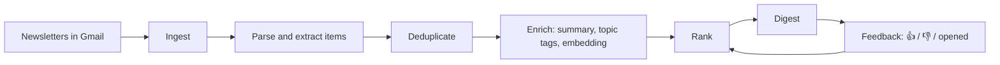

# Design: Newsletter Curator

Status: draft, edited as decisions are made. Decisions with evidence live in [`docs/adr/`](adr/). Spike results: [`docs/data-spike.md`](data-spike.md).

## 1. Problem and vision
Subscribing to many newsletters on AI and data science produces more links than there is time to read. The usual behavior is to skim the headings and open one or two. Interesting items get forgotten and are hard to find again. The tool should keep the user current in one short session a week.

**Goals:**
- Newsletters become **easier to digest**: recommendations based on the user's interests, and trending topics highlighted.
- Articles sorted into clear groups: **new**, **deep dives**, **trending topics**, and **topics I follow**.
- **Save for later**, with an optional reminder, and a way to find saved items again.

**One sentence:** a personal digest that turns newsletters into a short, sorted list of what is worth the reader's time, learns from feedback, and remembers what to read later.

## 2. How it is used
- **When:** **once a week**, 10–15 minutes for a quick check. Some weeks longer, to read interesting articles in depth. (Weekly, not daily, because the MVP sources are weekly newsletters.)
- **Where:** the weekly check on a **phone**, deep reading on a tablet or PC. The digest must work on a small screen, and saved items must be available on all devices.
- **What the user sees:** about 10 ranked items with a title, a 2-line summary, the source, and why it is shown.
- **What the user does:** open an item, or mark 👍 / 👎 / save for later, in one click.
- **Never wanted:** information overflow, so the digest has a **hard limit** on items. Also no setup or maintenance in the weekly flow, and no missing a very important item because the ranker is too narrow.

## 3. User stories
**Must (v1)**
1. One digest per week with the most relevant items from the last 7 days, within a **fixed limit** (about 10).
2. Duplicates across newsletters are merged into one item.
3. Each item has a short summary and the source newsletter.
4. 👍 / 👎 in one click, and the ranking uses it.
5. The digest has **groups**: new, deep dives, trending topics, and topics I follow.
6. **Save** an item for later and find saved items again in a list.

**Should (v2)**
7. Each item says **why** it is shown (similar to what was liked, new source, trending across newsletters).
8. **Reminder** for saved items, for example "saved 5 days ago" in the digest.
9. A small share of items is **exploratory** (new topics or sources), to avoid a bubble.

**Could (later)**
10. Recommend **new** articles from outside the newsletters (RSS, arXiv, Hacker News).
11. Weekly summary: what changed in the followed topics.
12. Ask questions over everything read ("what did people say about X this month?").
13. Phone access and hosting.

*The list can change. If the Musts turn out too big, move the groups (story 5) or saved-list features (story 6) down. "Trending" needs the clustering from the model sprint, so it may come after the first version.*

## 4. Scope: MVP and non-goals
**MVP:** stories 1–4 (digest with a limit, dedup, summaries, 👍/👎) for a **single user**, running **locally** as a web page. **MVP sources: Data Elixir, Data Science Weekly, True Positive Weekly.** All three are weekly curated-link lists, chosen for many items per issue and likely overlap (dedup, distinct-source baseline). Every other source is "later": each is one more parser/adapter.

**First after the MVP, in this order:**
1. **Save for later** with a saved list (story 6).
2. **Groups** (story 5): start with "new" and "topics I follow". "Deep dives" and "trending" follow when clustering exists.
3. **Why this item** (story 7).

**Non-goals for now:** more than the three MVP sources, multi-user, phone access and hosting, push notifications for reminders, external article discovery, full-text archive search, a polished web UI. Cloud deployment is decided later.

## 5. How it works (data flow)


| Step | What happens | Main concern |
|---|---|---|
| Ingest | Read newsletter emails (Gmail API or IMAP) | Adapters |
| Parse and extract | HTML → individual links/articles | Tests, template handling |
| Deduplicate | Canonicalize URLs, find near-duplicates | Entity matching |
| Enrich | LLM summary and tags, text embedding | GenAI, evals |
| Rank | Baseline → embedding classifier → LLM / hybrid | Classic ML vs. LLM |
| Digest | Produce the weekly list | API, container |
| Feedback | Store explicit and implicit signals | Implicit feedback, bandits |

## 6. What is an "item"?
**Decided: B, one article link is one item.** See [ADR 0001](adr/0001-item-unit.md) for the evidence.

| Option | Item = | Pros | Cons |
|---|---|---|---|
| A | A **newsletter issue** | Simple, little parsing | Too coarse: one issue mixes unrelated topics |
| B | An **article link** inside an issue | Fine-grained, matches what is actually read | Needs good parsing, links are messy (tracking URLs) |
| C | Both | Rank issues and links | More work |

The issue stays as context: each item keeps its source, issue and position. Not yet tested: newsletters with no links, only text (none among the spike sources).

**Cross-newsletter grouping:** the same article often appears in several newsletters. Merge these by canonical URL into **one item with a list of mentions** (which newsletters, which issue). The number of **distinct sources** per item is a popularity signal that needs no feedback. Similar articles with different URLs are grouped later by **topic clustering** on embeddings. Distinct-source count measures what the newsletter world cares about, not what the user cares about, so keep it separate from relevance in the evaluation.

## 7. Domain concepts
These become the **entities** in the core (see Clean Architecture in `CLAUDE.md`):
- **Source:** a newsletter (name, sender address)
- **Issue:** one email from a source (date, raw content)
- **Item:** one article, identified by its canonical URL (title, snippet), with its **mentions**: the issues and sources that link it (position in each issue)
- **Cluster:** a group of items about the same topic, from embedding similarity
- **Digest:** the ranked list shown in one weekly run
- **Feedback:** an event on an item (👍, 👎, saved, opened, ignored) with a timestamp

## 8. Feedback and labels
| Signal | Type | Meaning |
|---|---|---|
| 👍 / 👎 in the digest | explicit | strongest label |
| Saved for later | explicit | positive |
| Opened a link (click) | implicit | weak positive |
| Shown but not opened | implicit | weak, ambiguous negative (no time or no interest?) |
| Email starred / archived unread (Gmail backfill) | implicit | history before the app existed |

Open question: how to treat "shown but ignored" without learning the wrong lesson (negative sampling).

## 9. The digest (mock)
```text
Weekly digest, week of Mon 24 Nov

1. How we evaluate RAG systems in production           [The Batch]
   Practical guide to offline and online evals for retrieval pipelines.
   Why: similar to items you liked (evals, RAG)         [👍] [👎] [save]

2. A gentle intro to contextual bandits                [Import AI]
   ...
   Why: new topic, exploratory                          [👍] [👎] [save]
```
**Decision for the MVP:** a **local web page** (FastAPI) on the user's laptop, no hosting. Feedback links are simple there. Make the page mobile-friendly from the start, so a later move to a hosted version, or to an email digest, needs little change.

## 10. How we know it works
| Question | Measure |
|---|---|
| Is it better than no tool? | Time to find 5 good items; fewer newsletters opened by hand |
| Does the ranker beat the baseline? | NDCG@10 / recall@k on a time-based split vs. recency and distinct-source count |
| Are the clusters good? | ~30 hand-labeled pairs (same topic or not): precision and recall |
| Are the summaries good? | Golden set of ~30 items, rated 1–5 |
| ML vs. LLM vs. hybrid | Same split and metrics, plus cost and latency |
| Is it still used after a month? | Weeks (out of 4) in which the digest is opened |

## 11. Constraints
- **Privacy:** mail stays local; check what is sent to the LLM API. Raw emails are never committed (`data/`, `*.eml` and `*.mbox` are gitignored).
- **Cost:** LLM calls with a spending limit; cache enrichment results.
- **Language:** English newsletters first.

## 12. Open questions
- [x] **Item unit:** B, article link ([ADR 0001](adr/0001-item-unit.md))
- [x] **Which newsletters?** MVP: Data Elixir, Data Science Weekly, True Positive Weekly
- [x] **Gmail access (2026-11-23):** IMAP with an app password for the dedicated newsletter mailbox, read via an adapter behind an interface (credentials in env vars, never in code). Switching to the Gmail API later only replaces the adapter.
- [x] **Digest delivery:** local web page for the MVP; phone access, hosting or an email digest later
- [x] **When is the digest generated? (2026-11-23, working assumption)** Fridays, after about 06:00 JST. The 6 spike emails show the last issue of the week (Data Science Weekly, True Positive Weekly) arriving Thursday around 20:00 UTC; Data Elixir arrives Tuesday evening. The window is "new items since the last digest", not a fixed 7 days, so a late or skipped issue is neither lost nor duplicated and a re-run is safe. Revisit after the MVP: more sources will likely mean a more frequent digest. To verify: check the real cadence per source on the 3-month export (True Positive Weekly 183 to 184 is 14 days apart in the spike).
- [x] **Topics (parked on purpose, 2026-11-23):** no hand-written topic list. "Topics I follow" is to be derived from reading behavior (feedback signals, section 8). Consequence: the "topics I follow" group (story 5) depends on collected feedback and the cold start has to be handled (until enough feedback exists, rank by recency and distinct-source count). Revisit when the first feedback session is done.
- [x] **Exploration (2026-11-23):** 0% in the MVP (story 9 is v2). Revisit after about a month of real feedback.
- [x] **Full text (2026-11-23):** fetch and cache article text locally (gitignored `data/`) only for items that reach enrichment, because some sources (True Positive Weekly) give no blurb to summarize. No full-text archive search for now.
- [x] **Where does it run long term (parked on purpose, 2026-11-23):** local for the MVP; expected to move off the laptop later (hosting, phone access), decided in the production sprint. Until then, keep the code deployable: settings and secrets via environment variables, no hard-coded local paths, the app runs in a container, and the IMAP/fetch/storage details sit behind adapters.
- [x] **Fixtures (2026-11-23):** scrubbed real HTML structure in `tests/fixtures/<source>/issue_N.html` with gold labels next to it: real template markup, fake content and URLs, noise kept. No raw emails or real tracking URLs in git.
  - **Scrubbing (2026-11-25):** by hand, on a working copy in gitignored `data/`. The file moves to `tests/fixtures/` only after a leak search (tracking domain, own name and email addresses, real titles). Revisit a script if many more fixtures are needed.
- [x] **Parser input (2026-11-25):** the parser gets the decoded HTML, not the raw email. MIME decoding happens before it and is the same for all sources; template rules differ per source. So fixtures are `.html`, and the decode step needs its own test. `date` means the newsletter's publish date, not when the mail arrived.

## 13. Assumptions to test early (spikes)
1. **Newsletter HTML is parseable:** label the relevant links of 2 issues each of the 3 MVP sources by hand, then build the parser against one issue and validate on the other (the template is the unit of generalization, not the email). *Labeling done, see `docs/data-spike.md`.*
2. **Enough labels:** ~100 items rated in one session is enough to start; check how long that takes.
3. **Summaries are good enough:** summarize 10 items with an LLM and read them.
4. **A baseline is strong:** distinct-source count and recency may already beat a naive model; if so, the ML has to beat that.
5. **Overlap is real:** count how many articles in the spike emails appear in more than one newsletter, and check that URL canonicalization finds them. (First hits: two titles appear in two sources each; not yet counted systematically.)
